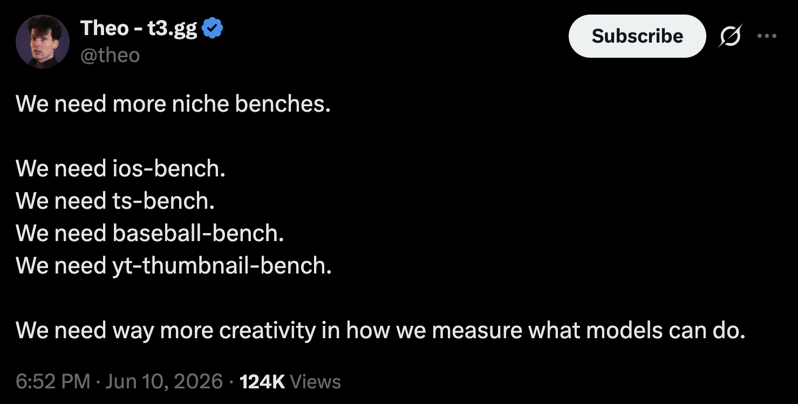
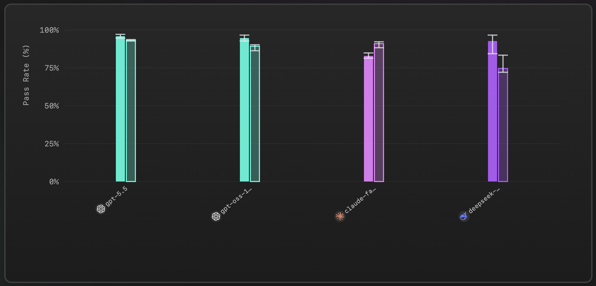
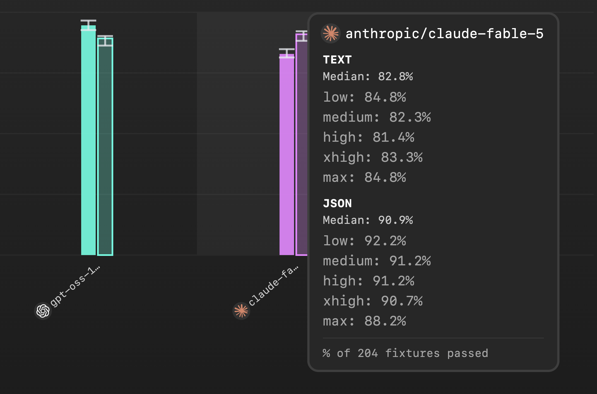
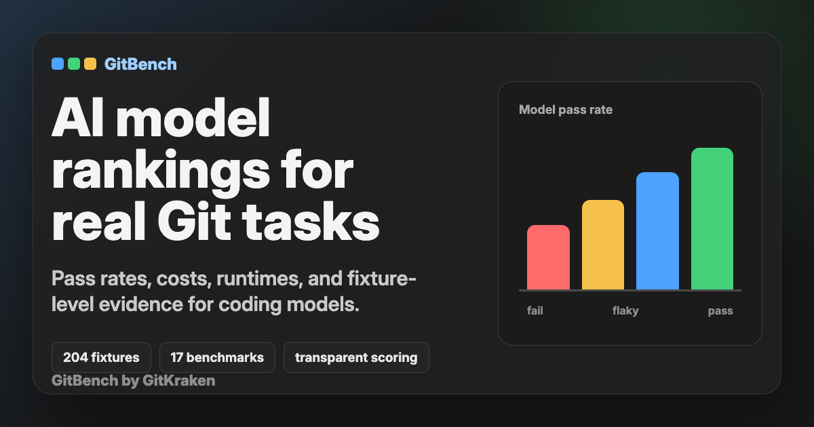

# Git Benched with GitBench
by GitKraken

---
layout: image-right
image: /self-portrait.jpg
---

# About Me

- Software Dev for ~10 years
- Developer Advocate at GitKraken
- Twitch Programming Streamer
- Snowboarder


---
layout: cover
background: /brand-3.png
---

# Why Benchmark?

Inspiration and Justifications

---
layout: image
image: /swebench.png
---

---
layout: image
image: /terminal-bench.png
---

---
layout: image
image: /artificial-analysis.png
---

---
layout: cover
background: /brand-4.png
---

# GitKraken AI

---
layout: image
image: /gk-commits.png
---

---
layout: image
image: /gk-commit-composer.png
---

---
layout: image
image: /gk-conflict.png
---

---
layout: image
image: /gk-explain.png
---

---



---

# Also... Fun!

I Wanted to try Spec-Driven Development:

- BMAD: https://github.com/bmad-code-org/bmad-method
- GSD
  - GSD: https://github.com/gsd-build/get-shit-done
  - GSD-2: https://github.com/gsd-build/gsd-2
- Openspec: https://openspec.dev/
- Spec-kit: https://github.com/github/spec-kit
- PAUL: https://github.com/ChristopherKahler/paul
- Superpowers: https://github.com/obra/Superpowers

---
layout: cover
background: /brand-2.png
---

# What is GitBench?

---

# GitBench's Moving Parts

- CLI
  - Python 
    - click for CLI args
    - rich for TUI output
- Web UI
  - Astro
  - Shadcn
  - Recharts
  - Vercel (API endpoints)
  - SQLite (instead of a 20+ MB JSON file)

---
layout: image
image: /openrouter.png
---

---
layout: fact
---

# Warning: Vibe-Coded

---
layout: fact
---

# GSD2 -> Openspec

---
layout: cover
background: /bobross-1.webp
---

# Happy Little Surprises

---

# Structured Output

JSON Schema vs Raw Text Output

- Some models don't even support this
- Some give broken output (Need to validate)

```json
{
  "The Commit message we were expecting but inside invalid JSON"
}
```

---


---

# Commit Messages

## Generative Results:  Needed LLMs as Judges

Models:
- ibm-granite/granite-4.1-8b
- google/gemma-4-26b-a4b-it
- openai/gpt-oss-120b:xhigh

---

# Semantic Scoring as the Wrong Approach

## Conflict Resolution

Similarity doesn't make sense as a scoring mechanism.

Merge Conflict Resolution should be deterministic

---
layout: cover
background: /brand-1.png
---

# The Biggest Surprise?

---
layout: fact
---

# NSFW Content

---
layout: image
image: /nsfw.jpg
---

---
layout: image
image: /nsfw-part-2.png
---

---
layout: fact
---

# Nemotron is AGI

---
layout: cover
background: /brand-5.png
---

# Teased Results

---
layout: image
image: /gitbench-results-general.png
---

---

# Effort and Structured Output Results Are Unintuitive



---



---
layout: cover
background: /brand-2.png
---

<h2>Demo: Live Results</h2>

---
layout: statement
---



https://gitbench.gitkraken.com

---
layout: cover
---

# Thanks!

## Connect With Me


